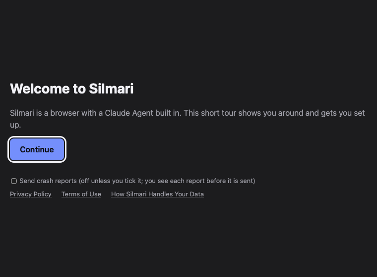

# Silmari

Silmari is a web browser for Mac with a built-in AI assistant that can read pages, fill forms and work with your files when you allow it.

**Runs on:** Mac (Apple silicon and Intel), macOS 13 or later.

## Testers: download the test version

[Download Silmari 1.0.0 beta 1 for Mac](https://github.com/tha-hammer/silmari-releases/releases/download/v1.0.0-beta.1/Silmari.dmg)

This test version is not signed by Apple yet, so your Mac blocks it the first time. You let it open once, as shown below. After that it opens normally.

[Release notes](https://github.com/tha-hammer/silmari-releases/releases/tag/v1.0.0-beta.1)

## Install the test version

1. Open the downloaded `Silmari.dmg`.
2. Drag Silmari to the Applications folder.
3. Open Silmari from Applications. Your Mac says it cannot check Silmari for malware. Click **Done**.

4. Open **System Settings**, click **Privacy & Security**, and scroll down to **Security**. Next to "Silmari was blocked", click **Open Anyway**.

5. Click **Open Anyway** again and type your Mac password.

Do this within an hour of step 3. Right-click and Open no longer works on new versions of macOS. You only do this once for each test version.

Silmari then opens with this welcome screen:

To use the assistant, open the assistant panel and choose **Sign in**. You need your own Claude account.

## New test versions

The test version does not update itself yet. When we send you a new test version, download it from this page and drag it to Applications again (choose **Replace**). Your settings and chats stay.

## Your data

- [Privacy Policy](PRIVACY.md)
- [Terms of Use](TERMS.md)
- [How Silmari Handles Your Data](DATA.md)
